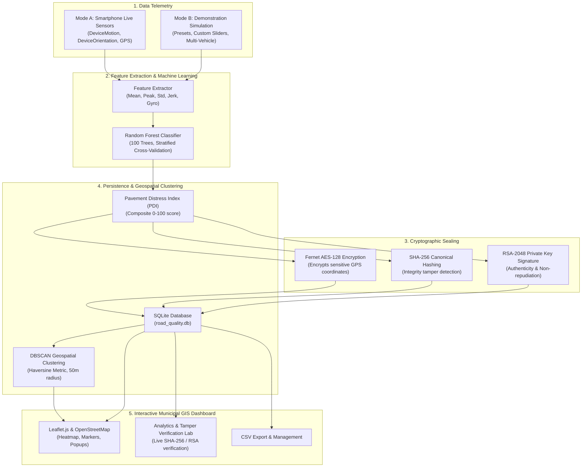

# Secure Crowdsourced Road Quality Monitoring & Pothole Severity Detection System

[](https://www.python.org/)
[](https://flask.palletsprojects.com/)
[](https://scikit-learn.org/)
[](https://cryptography.io/)
[](https://leafletjs.com/)

An end-to-end civic-technology engineering mini-project designed for 5th-Semester Computer Science & Engineering (CSE). This system crowdsources smartphone accelerometer and gyroscope telemetry from vehicles, cleans and engineers physical features, classifies road anomalies using a **Random Forest Classifier**, seals records with **Fernet encryption, SHA-256 integrity digests, and RSA-2048 digital signatures**, clusters nearby reports using **DBSCAN with the Haversine metric**, calculates a **Pavement Distress Index (PDI)**, and presents real-time data on an interactive **Leaflet/OpenStreetMap municipal GIS dashboard**.

---

## Table of Contents
1. [Problem Statement & Objectives](#problem-statement--objectives)
2. [Key Features](#key-features)
3. [Technology Stack](#technology-stack)
4. [System Architecture](#system-architecture)
5. [Directory Structure](#directory-structure)
6. [Prerequisites & System Requirements](#prerequisites--system-requirements)
7. [Installation & Windows 11 Setup Guide](#installation--windows-11-setup-guide)
8. [Running the Application](#running-the-application)
9. [How to Use the System](#how-to-use-the-system)
   - [Mode A — Smartphone Live Sensor Mode](#mode-a--smartphone-live-sensor-mode)
   - [Mode B — Demonstration & Simulation Mode](#mode-b--demonstration--simulation-mode)
10. [Machine Learning Pipeline](#machine-learning-pipeline)
11. [Geospatial Clustering (DBSCAN)](#geospatial-clustering-dbscan)
12. [Pavement Distress Index (PDI)](#pavement-distress-index-pdi)
13. [Cryptography & Security Architecture](#cryptography--security-architecture)
14. [Automated Testing Suite](#automated-testing-suite)
15. [Troubleshooting](#troubleshooting)
16. [Academic Disclaimer & Future Enhancements](#academic-disclaimer--future-enhancements)

---

## 1. Problem Statement & Objectives

### The Problem
Municipal public works departments often rely on slow, manual road inspections and delayed citizen complaint hotlines to detect potholes, damaged pavements, and unscientific speed breakers. This results in:
- High vehicular wear-and-tear and road accidents.
- Lack of exact geospatial coordinates and severity metrics.
- Vulnerability of complaint records to unauthorized alteration or spoofing.

### The Proposed Solution
Our system provides an automated, secure crowdsourcing pipeline:
1. **Telemetry Collection:** Vehicles passively record vibration signals via smartphone inertial measurement units (IMUs) and GPS.
2. **Feature Extraction:** Transforms multi-axis acceleration and rotation signals into physical features (vector magnitude, peak impact, standard deviation, jerk, and rotational velocity).
3. **Machine Learning:** Evaluates signals using a trained **Random Forest Classifier** to distinguish **Normal Road**, **Speed Breaker**, and **Pothole**.
4. **Cryptographic Protection:** Encrypts sensitive GPS coordinates using **Fernet (AES-128)**, signs accepted records using municipal server **RSA-2048 digital signatures**, and generates **SHA-256 hashes** for tamper detection.
5. **DBSCAN Clustering:** Groups independent vehicle detections within a 50-meter radius to eliminate false positives and calculate crowdsource consensus.
6. **Pavement Distress Index (PDI):** Computes a 0–100 priority score to help municipal authorities schedule road repairs objectively.

---

## 2. Key Features

- **Civic-Technology Dashboard:** Modern dark-slate UI displaying real-time metrics, severity distribution, recent telemetry streams, and top clustered hotspots.
- **Interactive Leaflet/OSM GIS Map:** Color-coded markers based on priority (Low, Moderate, High, Critical) with DBSCAN spatial consensus circles and popup inspection.
- **Dual Telemetry Ingestion Modes:**
  - *Mode A (Live Sensor Mode):* Hardware DeviceMotion, DeviceOrientation, and Geolocation APIs.
  - *Mode B (Demonstration Mode):* Deterministic 1-click presets and customizable parameter sliders for live evaluation without needing to drive on a road.
- **DBSCAN Geospatial Clustering:** Density-based spatial grouping using great-circle Haversine distance.
- **Transparent PDI Prioritization:** Formula combining classification weight, kinematic impact G-force, model confidence, and independent vehicle consensus.
- **Real Cryptographic Verification & Tamper Lab:**
  - Inspect decrypted vs. encrypted coordinates.
  - Live SHA-256 and RSA-2048 verification.
  - Interactive "Simulate Tamper" button demonstrating instant cryptographic warning upon unauthorized database edits.
- **CSV Data Export:** One-click download of all records directly from SQLite.
- **100% Offline & Free:** No paid mapping APIs, API keys, or cloud services required.

---

## 3. Technology Stack

| Layer | Technologies |
| :--- | :--- |
| **Frontend** | HTML5, CSS3, JavaScript (ES6+), Leaflet.js 1.9.4, Chart.js 4.4, OpenStreetMap Tiles |
| **Backend** | Python 3.10+, Flask 3.1+, Flask-CORS |
| **Database** | SQLite3 (Persistent local storage) |
| **Data Processing & ML** | NumPy, pandas, scikit-learn (RandomForestClassifier, DBSCAN), joblib |
| **Security & Cryptography** | `cryptography` library (Fernet symmetric encryption, RSA-2048 PKCS#1 v1.5, SHA-256) |
| **Testing** | Python `unittest` |

---

## 4. System Architecture



---

## 5. Directory Structure

```text
RoadQualityMonitor/
│
├── app.py                     # Main Flask application entrypoint & factory
├── config.py                  # Central configuration (paths, thresholds, keys)
├── requirements.txt           # Python dependencies
├── .env.example               # Environment variables template
├── .gitignore                 # Git ignore rules
├── README.md                  # Comprehensive setup & project guide
├── PROJECT_EXPLANATION.md     # Viva defense guide & simple conceptual notes
│
├── frontend/
│   ├── templates/
│   │   └── index.html         # Single-page civic dashboard
│   └── static/
│       ├── css/
│       │   └── style.css      # Modern dark-slate civic-tech styles
│       └── js/
│           ├── app.js         # Navigation tabs, notifications & UI controller
│           ├── sensors.js     # Mode A & Mode B telemetry collection engine
│           ├── map.js         # Leaflet.js GIS mapping & DBSCAN cluster overlays
│           └── dashboard.js   # Metrics, charts, table, modal & CSV export
│
├── backend/
│   ├── __init__.py            # Backend package initialization
│   ├── database.py            # SQLite connection, schema, CRUD & queries
│   ├── routes.py              # Flask REST API endpoints
│   ├── detection.py           # Core ingestion & classification pipeline
│   ├── preprocessing.py       # Kinematic feature extraction & vector conversion
│   ├── clustering.py          # DBSCAN Haversine geospatial clustering
│   ├── severity.py            # Pavement Distress Index (PDI) scoring formula
│   └── crypto_utils.py        # Fernet encryption, SHA-256 hash & RSA signatures
│
├── ml/
│   ├── generate_dataset.py    # Synthetic sensor dataset generator
│   ├── train_model.py         # Random Forest training script & metrics
│   ├── predict.py             # Inference module with automatic model loader
│   ├── sample_sensor_data.csv # 450 labeled synthetic sensor samples
│   └── model/
│       ├── road_classifier.joblib  # Trained Random Forest model artifact
│       ├── scaler.joblib           # Fitted StandardScaler artifact
│       └── model_metadata.json     # Accuracy, metrics & disclaimer
│
├── data/
│   ├── .gitkeep               # Directory placeholder
│   ├── road_quality.db        # SQLite persistent database (created at runtime)
│   └── keys/                  # Cryptographic keys
│       ├── secret.key         # Fernet symmetric encryption key
│       ├── private_key.pem    # RSA 2048-bit server private key
│       └── public_key.pem     # RSA 2048-bit server public key
│
├── scripts/
│   ├── init_db.py             # Database creation script
│   ├── generate_keys.py       # Cryptographic key generation script
│   └── seed_demo_data.py      # Multi-vehicle demonstration data seeder
│
└── tests/
    ├── test_crypto.py         # Unit tests for Fernet, SHA-256 & RSA signatures
    ├── test_ml.py             # Unit tests for features & model predictions
    ├── test_clustering.py     # Unit tests for DBSCAN grouping & noise handling
    └── test_api.py            # Integration tests for Flask API & tamper detection
```

---

## 6. Prerequisites & System Requirements

- **Operating System:** Windows 10 / Windows 11 (or macOS / Linux)
- **Python:** Python 3.10, 3.11, 3.12, 3.13, or 3.14
- **Editor:** Visual Studio Code (VS Code) recommended
- **Web Browser:** Google Chrome, Microsoft Edge, or Mozilla Firefox
- **Network:** Works completely offline (CDN styles & OpenStreetMap tiles cache automatically; local fallbacks included)

---

## 7. Installation & Windows 11 Setup Guide

Follow these exact steps in **VS Code Terminal (PowerShell)**:

### Step 1: Open Project in VS Code
Open VS Code and choose **File > Open Folder...**, then select:
```text
C:\Users\<username>\Desktop\RoadQualityMonitor
```

### Step 2: Open PowerShell Terminal
In VS Code, press ``Ctrl + ` `` (Backtick) or go to **Terminal > New Terminal**. Verify you are in the project folder:
```powershell
pwd
```

### Step 3: (Recommended) Create & Activate Virtual Environment
```powershell
python -m venv venv
.\venv\Scripts\Activate.ps1
```
*(If PowerShell displays an `Execution_Policies` restriction, run: `Set-ExecutionPolicy -Scope Process -ExecutionPolicy Bypass` and then run the activation command again).*

### Step 4: Install Required Packages
```powershell
python -m pip install -r requirements.txt
```

---

## 8. Running the Application

### One-Time Initialization Commands
Run these three commands to initialize the cryptographic keys, SQLite database, and train the Random Forest model:

```powershell
# 1. Generate Fernet symmetric key and RSA-2048 key pair
python scripts/generate_keys.py

# 2. Initialize the SQLite database tables
python scripts/init_db.py

# 3. Train the Random Forest Machine Learning Model
python ml/train_model.py

# 4. (Optional) Seed realistic demonstration road clusters
python scripts/seed_demo_data.py
```

### Start the Flask Server
Run this command whenever you want to start the application:
```powershell
python app.py
```

You will see:
```text
======================================================================
 ROAD QUALITY MONITOR & POTHOLE SEVERITY DETECTION SYSTEM
 5th-Semester CSE Engineering Mini-Project Prototype
======================================================================
 * Server running on: http://127.0.0.1:5000/
 * Open this URL in your web browser (Chrome, Edge, Firefox)
 * Press Ctrl+C in this terminal to stop the server
======================================================================
```

Open your browser and navigate to:
```text
http://127.0.0.1:5000/
```

---

## 9. How to Use the System

### Mode A — Smartphone Live Sensor Mode
1. Open `http://<your-laptop-ip>:5000/` or `http://localhost:5000/` on a device with motion sensors (e.g. mobile browser).
2. Navigate to the **Sensor Ingestion & Demo** tab.
3. Click **▶️ Start Live Sensor Ingestion**.
4. The browser will prompt for Geolocation permission.
5. Watch real-time multi-axis acceleration and gyroscope values update live.
6. When a physical vehicle shock or vertical displacement exceeds threshold (\(|a - 9.8| > 6.0\text{ m/s}^2\)), the frontend automatically dispatches telemetry to the AI classifier.

### Mode B — Demonstration & Simulation Mode (Laptop Friendly)
Use this mode in front of examiners to test every pipeline phase without requiring an actual vehicle:
1. Open the **Sensor Ingestion & Demo** tab.
2. Under **Mode B**, test the 1-click anomaly presets:
   - **💥 Pothole Shock:** Sets peak acceleration to `22.5 m/s²` and gyroscope to `2.4 rad/s`.
   - **⚡ Speed Breaker:** Sets peak acceleration to `14.0 m/s²` and gyroscope to `1.2 rad/s`.
   - **🛣️ Normal Road:** Sets peak acceleration to `10.1 m/s²` and gyroscope to `0.05 rad/s`.
3. Pick a location preset (e.g. *Outer Ring Road*, *Indiranagar*, or custom coordinates).
4. Click **🚀 Dispatch Telemetry to AI & Crypto Pipeline**.
5. Observe the live result card displaying predicted class, model confidence, PDI score, and preview hashes.
6. Switch to the **GIS Heatmap** tab or **Dashboard Overview** to see the new marker appear immediately.

---

## 10. Machine Learning Pipeline

### 1. Extracted Kinematic Features
From raw acceleration (\(a_x, a_y, a_z\)) and gyroscope angular velocity (\(\omega_x, \omega_y, \omega_z\)), we calculate:
1. `accel_mag_mean`: Mean acceleration magnitude \(\sqrt{a_x^2 + a_y^2 + a_z^2}\).
2. `accel_mag_max`: Maximum peak acceleration excursion.
3. `accel_mag_std`: Standard deviation / variance of acceleration across the sample window.
4. `accel_z_delta`: Peak deviation from nominal gravity \(|a_z - 9.80665|\).
5. `accel_jerk`: Rate of change of acceleration \(\max |\Delta a|\).
6. `gyro_mag_mean`: Mean rotational velocity magnitude \(\sqrt{\omega_x^2 + \omega_y^2 + \omega_z^2}\).

### 2. Random Forest Model Architecture
- **Algorithm:** `RandomForestClassifier` (100 estimators, max depth 8, balanced class weights).
- **Evaluation:** 80% train / 20% test stratified split with `StandardScaler`.
- **Target Classes:**
  - `0`: Normal Road
  - `1`: Speed Breaker
  - `2`: Pothole
- **Evaluation Metrics:** Evaluated for Accuracy, Precision, Recall, F1-Score, and Confusion Matrix.

### Retraining Instructions
To retrain the model at any time with updated or augmented data:
```powershell
python ml/train_model.py
```

---

## 11. Geospatial Clustering (DBSCAN)

Road anomalies reported by multiple cars driving down the same avenue must be consolidated rather than counted as separate potholes:
- **Algorithm:** Density-Based Spatial Clustering of Applications with Noise (DBSCAN) from `scikit-learn`.
- **Distance Metric:** Great-circle **Haversine metric** (\(d = 2R \arcsin \sqrt{\sin^2(\Delta \phi / 2) + \cos \phi_1 \cos \phi_2 \sin^2(\Delta \lambda / 2)}\)).
- **Parameters:**
  - \(\epsilon = 0.05\text{ km}\) (50 meters, converted to radians: \(\epsilon / 6371.0088\)).
  - \(min\_samples = 2\) (Requires at least 2 reports to form a confirmed hotspot).
- **Crowdsource Consensus:** Clusters calculate the count of **distinct contributing devices** (`unique_devices`), proving multi-vehicle validation.

---

## 12. Pavement Distress Index (PDI)

A transparent municipal prioritization score ranging from **0.0 to 100.0**:

### Single Detection Formula
$$\text{Base} = \begin{cases} 5.0 & \text{Normal Road} \\ 35.0 & \text{Speed Breaker} \\ 70.0 & \text{Pothole} \end{cases}$$

$$K_{\text{shock}} = \min\left(20.0, \frac{\text{peak} - 9.8}{15.0} \times 20.0\right) \quad (\text{if peak} > 9.8)$$

$$PDI_{\text{single}} = \min(100.0, (\text{Base} + K_{\text{shock}}) \times (0.8 + 0.2 \times \text{confidence}))$$

### Clustered Consensus Formula
When multiple vehicles confirm an anomaly:
$$PDI_{\text{cluster}} = \min\left(100.0, \bar{S}_{\text{base}} + \min(15.0, \ln(N + 1) \times 4.5) + \min(15.0, (U_{\text{devices}} - 1) \times 5.0)\right)$$

### Priority Levels
- **0.0 – 29.9:** Low (Green)
- **30.0 – 59.9:** Moderate (Amber/Yellow)
- **60.0 – 79.9:** High (Orange)
- **80.0 – 100.0:** Critical (Red/Crimson)

---

## 13. Cryptography & Security Architecture

1. **Fernet Symmetric Encryption (AES-128-CBC + HMAC-SHA256):**
   - Citizen GPS coordinates and device IDs are encrypted before being stored in SQLite.
   - Key is stored locally in `data/keys/secret.key` and never transmitted to the frontend.
   - Coordinates are decrypted only when authorized municipal functions request map rendering or inspection.

2. **SHA-256 Canonical Hashing (Integrity):**
   - Canonical representation (sorted keys, uniform float rounding) produces a deterministic 64-character hex digest.
   - Used to verify whether any record was modified in the database.

3. **RSA-2048 Digital Signatures (Authenticity & Non-Repudiation):**
   - Accepted records are signed by the server's private key (`private_key.pem`) using PKCS#1 v1.5 padding with SHA-256.
   - Anyone holding the public key (`public_key.pem`) can verify the record was authored and approved by the municipal server.

---

## 14. Automated Testing Suite

To run all automated unit and integration tests:
```powershell
python -m unittest discover -s tests
```

Expected output:
```text
.................
----------------------------------------------------------------------
Ran 17 tests in 0.602s

OK
```

All 17 tests verify:
- Symmetric Fernet encryption and decryption.
- Canonical JSON construction and SHA-256 digest creation.
- SHA-256 tamper rejection.
- RSA-2048 signature generation and public-key verification.
- RSA signature failure on tampered payloads.
- Kinematic feature extraction from multi-axis windows.
- Random Forest model predictions across all 3 classes.
- DBSCAN Haversine clustering and noise outlier handling.
- Flask endpoints (`/`, `/api/stats`, `/api/detections`, `/api/clusters`, `/api/export/csv`).
- Tamper simulation API and cryptographic audit failure.
- Graceful execution when SQLite database is empty.

---

## 15. Troubleshooting

| Issue | Cause | Solution |
| :--- | :--- | :--- |
| `python: command not found` | Python not added to Windows PATH | Ensure Python is installed and check "Add python.exe to PATH" in the installer. |
| `Script execution is disabled` | PowerShell ExecutionPolicy | Run: `Set-ExecutionPolicy -Scope Process -ExecutionPolicy Bypass` |
| `Port 5000 is already in use` | Another process is using port 5000 | In PowerShell, run `Stop-Process -Id (Get-NetTCPConnection -LocalPort 5000).OwningProcess -Force` or run with `PORT=5001 python app.py`. |
| Map tiles not showing | Missing Internet connection on first load | Connect to Internet once so Leaflet & OpenStreetMap tiles cache, or check network connectivity. |
| DeviceMotion returns null | Running on desktop/laptop browser | Expected behavior on laptops without motion sensors. Use **Mode B (Demonstration Mode)**. |

---

## 16. Academic Disclaimer & Future Enhancements

### Disclaimer
This system is an academic engineering prototype developed for 5th-semester CSE curriculum evaluation. Machine learning models were trained on physical kinematic simulation data engineered to model vehicle vibrations over road anomalies. It is intended for coursework demonstration, not as an officially certified municipal civil engineering tool.

### Future Enhancements
- Integration of smartphone camera computer vision (YOLOv8) with inertial sensors for multi-modal validation.
- Edge-device TensorFlow Lite / ONNX quantization for on-device inference directly inside native mobile apps.
- Municipal maintenance work-order routing integration with civic ERP systems.
